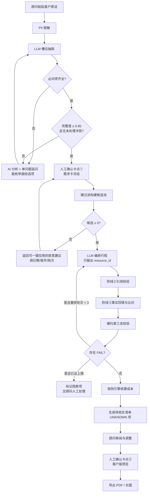
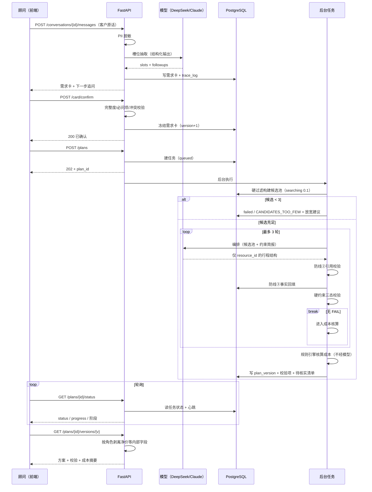

# 产品基建设计文档（0→1 总纲）
## 高端旅行智能方案生成平台「行策」

> 本文是项目的**总纲**：一个人从这里开始，应该能读懂产品为谁做、做什么、怎么串起来、哪里会出错、做到什么程度算完。
> 细节不在本文展开，各节给出跳转：需求细节看 [PRD-v2](高端旅行智能方案生成平台-PRD-v2.md)，实施细节看 [PRD-v3 实施版](PRD-v3-实施版.md)，功能清单看 [核心功能 PRD（功能矩阵）](04-核心功能PRD-功能矩阵.md)。

---

## 1. 版本记录

| 版本 | 日期 | 修订人 | 主要变更 |
| --- | --- | --- | --- |
| v0.1 | 2026-09-06 | 产品 | PRD 初稿，问题定义与设计主张 |
| v0.2 | 2026-09-07 | 产品 | PRD-v2：补齐 7 条关键决策、评测体系、风险清单 |
| v0.3 | 2026-09-07 | 产品 | PRD-v3 实施版：范围收敛为 M0/M1/M2，给出 DDL 与接口契约 |
| v0.4 | 2026-09-08 | 产品 + 研发 | M0 最小可跑闭环上线；接入 DeepSeek；正式前端 |
| v0.5 | 2026-09-10 | 产品 + 研发 | 需求采集改为多轮引导式；客户版方案导出 |
| v0.6 | 2026-09-11 | 产品 + 研发 | 候选不足的可恢复流程；生成过程可视化 |
| **v1.0** | **2026-09-17** | **产品** | **本文（总纲）建立；补齐调研/立项/埋点/排期/Badcase 文档链** |

---

## 2. 人员与分工

| 角色 | 人 | 职责 | 备注 |
| --- | --- | --- | --- |
| 产品负责人 | SabreZSY | 需求定义、优先级、验收、评测标准 | 一人多角 |
| 研发（后端） | SabreZSY | FastAPI / 规则引擎 / 编排 / 数据层 | AI 辅助开发 |
| 研发（前端） | SabreZSY | Next.js 顾问工作台 / 交付导出 | AI 辅助开发 |
| 业务顾问（外部） | ⛔ 待接入 | 一线痛点校验、评测标注、基线工时 | **当前空缺，是最大方法论缺口** |
| 数据运营 | ⛔ 待接入 | 真实资源录入与时效维护 | M0 用合成数据替代 |

> ⚠️ **诚实说明**：本项目当前是单人项目，「业务顾问」与「数据运营」为空缺。所有关于一线痛点的判断来自二手观察，[立项报告 §7](02-立项报告.md) 的 H1–H5 假设**尚未验证**。这是本项目最需要补的一环，不靠增加功能能解决。

---

## 3. 大排期

| 阶段 | 时间 | 交付 | 状态 |
| --- | --- | --- | --- |
| 调研与立项 | 2026-09-06 ~ 09-07 | 行业分析、PRD-v2、PRD-v3 | ✅ |
| **M0 最小可跑闭环** | 2026-09-07 ~ 09-15 | 端到端链路 + 前端工作台 + 客户版交付 | ✅ |
| 文档基建补齐 | 2026-09-17 | 本文档链（01–10） | ✅ |
| 假设验证 | 待定 | H1–H5 工时基线与标注 | ⛔ 阻塞：需业务方 |
| **M1 语义检索** | 待定 | pgvector 双路召回 + RRF 融合 | 未启动 |
| **M2 编辑能力** | 待定 | 锁定 + 增量重排 + 版本对比 | 未启动 |

细化到功能粒度的排期见 [功能排期表](06-功能排期表.md)。

---

## 4. 用户痛点

| # | 痛点 | 场景描述 | 现状代价 | 产品对策 | 优先级 |
| --- | --- | --- | --- | --- | --- |
| P1 | 需求问不全 | 做到一半才发现没问忌口 / 预算是否含机票 | 整单返工 | 必问项强制确认（4 项），缺失即阻塞生成 | P0 |
| P2 | 模糊表达难落地 | 「老人生冷的少一点」「走不了太多路」 | 靠顾问脑补，脑补错了就返工 | 模型抽取 + 转为枚举选项追问，不问开放题 | P0 |
| P3 | 资源查找耗时 | 资料散在 PDF / 邮件 / 群聊 / 同行 | 单方案约 3 小时（假设待验证） | 结构化硬过滤，秒级候选池 | P0 |
| P4 | 经验不可复用 | 「哪家旅馆不接 6 岁以下」只在老顾问脑子里 | 新人无法独立出稿 | 约束写成规则（H1–H11）+ 结构化字段 | P0 |
| P5 | 踩坑不可见 | 周一闭馆、房型住不下、车装不下行李 | 对客事故 | 硬约束三态校验 + 自动重排 | P0 |
| P6 | 手算成本易错 | Excel 逐项累加汇率与服务费 | 算错即吃掉利润 | 规则引擎确定性核算，模型不碰金额 | P0 |
| P7 | 出稿排版慢 | Word 逐单排版 | 首稿周期长 | 客户版渲染 + PDF / 长图一键导出 | P1 |
| P8 | 改比重做慢 | 客户改一句，全案重来 | 顾问弃用风险 | 锁定 + 增量重排（M2） | P1 |
| P9 | AI 不可信 | 模型编酒店、编价格 | 不敢对客 | 三道防线 + 逐项来源标记 | P0 |

---

## 5. 目标用户

### 5.1 用户画像

| 画像 | 谁 | 核心诉求 | 使用频次 | 本产品对其价值 |
| --- | --- | --- | --- | --- |
| **主要用户 · 资深顾问** | 从业 3 年以上，手握客户与资源关系 | 别让我重复劳动，但方案必须由我把关 | 每周数次 | 省掉检索与核算，保留判断权 |
| **主要用户 · 新人顾问** | 从业 1 年内 | 我不知道有哪些资源可选 | 每周数次 | 系统给出结构正确的首稿 |
| 次要用户 · 销售 | 对接客户但不做方案 | 快速给客户一个像样的东西 | 不定期 | 客户版预览与导出（**看不到净价**） |
| 次要用户 · 主管 | 审核与定价 | 方案是否有硬伤、利润是否够 | 每单一次 | 校验结果与成本结构 |
| 次要用户 · 采购 | 维护供应商与协议价 | 数据是否过期 | 每周 | 时效与待核实清单 |

### 5.2 非目标用户（明确不服务）

- **C 端旅行者**：不做自助规划，本产品的价值前提是「有一个专业顾问最终把关」；
- **标准跟团游组团社**：他们的产品是标品，不需要逐单编排；
- **纯 OTA 比价用户**：本产品不做比价，不做库存查询。

### 5.3 典型场景

| 场景 | 输入 | 期望输出 |
| --- | --- | --- |
| 家庭亲子 | 「两大一小，孩子 5 岁，10 月中京都四天，住奢华档」 | 房型容量与儿童政策全部合规的行程 |
| 蜜月纪念 | 「夫妻二人，东京 5 天，预算不设上限」 | 档次匹配、纪念日安排 |
| 深度文化 | 「四位，京都一周，老人生冷少一点，走不了太多路」 | 休馆日避坑、节奏放缓、饮食与无障碍适配 |

---

## 6. 竞品结论（详见竞品分析）

| 类型 | 代表 | 敢不敢对客交付 | 差距 |
| --- | --- | --- | --- |
| 通用 AI 行程生成 | Mindtrip、Layla、Wonderplan | ❌ | 无协议价、无约束校验，错了用户自担；且第三方评测已公开点名其营业时间/价格/可订状态的幻觉风险 |
| OTA 的 AI 助手 | 携程问道 + TripGenie、飞猪帮帮 | ⚠️ 标品可以 | **目标函数是转化不是正确**；协议价与私域资源进不了平台库 |
| B 端定制师工作台 | 路书云 TOS、超级定制师 | —— | 管编排不管事实：官方口径「80% 人工 + 20% 智能」，报价仍需手工上 OTA 查录 |
| 自营定制旅行社 | 6 人游、无二之旅、赞那度 | —— | **是客户不是对手**；其公开痛点数据佐证了本项目前提 |
| **行策** | —— | ✅ 设计目标 | 以「事实可核验」为第一目标，面向顾问而非旅行者 |

完整维度对比、实名产品拆解与数据来源见 [竞品分析](09-竞品分析.md)。

---

## 7. 优先级

采用 **P0 = 不做就不成立 / P1 = 影响体验与采纳 / P2 = 锦上添花**。

| 优先级 | 定义 | 本项目的 P0 清单 |
| --- | --- | --- |
| **P0** | 缺了产品逻辑不成立，或会造成对客事故 | 需求卡与必问项、硬过滤、三道防线、硬约束校验、成本规则引擎、人工确认卡点、净价隔离 |
| **P1** | 不影响正确性但显著影响顾问是否愿意用 | 多轮引导体验、生成过程可视化、候选不足的恢复建议、客户版导出、锁定与增量重排 |
| **P2** | 后续增强 | 语义检索、多方案对比、版本 diff、协作审批 |

功能粒度的优先级与实现状态见 [功能矩阵](04-核心功能PRD-功能矩阵.md)。

---

## 8. 各链路

系统共四条链路，**每条链路都必须能独立降级**，一条挂掉不应让整个产品不可用。

| 链路 | 输入 → 输出 | 关键组件 | 降级策略 |
| --- | --- | --- | --- |
| **L1 需求采集链路** | 客户原话 → 结构化需求卡 | 槽位抽取（LLM）、必问项补全、冲突检测、完整度计算 | 模型失败 → 规则引导（`source: rules`），顾问手填 |
| **L2 检索链路** | 需求卡 → 候选池 | 硬过滤（城市/日期/容量/儿童/档次/偏好）、排序 | 候选 < 3 → 不硬生成，返回可一键应用的放宽建议 |
| **L3 生成校验链路** | 候选池 → 已校验行程 | LLM 编排 → 引用校验 → 事实回填 → 约束校验 → 自动重排（≤3 轮） | `PLANNER_MODE=heuristic` 确定性编排器兜底 |
| **L4 交付链路** | 方案 → 客户版 PDF / 长图 | 客户版渲染（剥离内部字段）、前端导出 | 导出失败 → 仍可在页面预览 |

### 8.1 L1 需求采集

~~~
客户原话 ──PII 脱敏──→ 槽位抽取（15 槽位，带 source + confidence）
                          ↓
                    必问项检查（dietary / accessibility / budget_basis / budget_incl_flight）
                          ↓
                    冲突检测（C1 预算×档次 / C2 天数×城市 / C3 房型×人数）
                          ↓
                    完整度加权计算（阈值 0.85）
                          ↓
                    AI 分析 + 一次只问一个问题（能枚举就给选项）
                          ↓
                    顾问确认 → 需求卡冻结（版本 +1）
~~~

**设计要点**：
- 每个槽位都带 `source`（client_verbatim / advisor_input / system_inferred）与 `confidence`，顾问填写的值**不被模型改写**；
- 追问每轮 ≤ 3 条，超出由服务层截断并记 warning；
- 必问项**不得静默假设为「无」**——「客户没说忌口」不等于「没有忌口」。

### 8.2 L2 检索

硬过滤条件：目的地城市、入住/退房日期可售、房型容量 ≥ 人数、儿童年龄政策、酒店档次、饮食标签、无障碍、车辆座位与行李容量。

- 排序权重可配置：标签匹配 0.50 / 价格匹配 0.30 / 时效 0.20 / 商业优先级 0.00；
- **商业优先级权重上限锁死 0.10**（代码级 validator 强制，不可调高）——这是产品决策，不是配置项。

### 8.3 L3 生成与校验（核心）

三道防线：

| 防线 | 做什么 | 拦住什么 |
| --- | --- | --- |
| ① Schema 约束 | 模型只能输出候选池里的 `resource_id`，输出结构由 JSON Schema 约束 | 结构错乱、自由发挥 |
| ② 引用校验 | 服务端逐个检查 ID 是否真的在本次候选池内 | **ID 看起来合理但根本不存在/不在池内** |
| ③ 事实回填与比对 | 用 DB 里的真实字段覆盖模型输出，再比对是否一致 | 名称、容量、营业时间、价格被篡改 |

硬约束（三态判定）：

| 代码 | 约束 | UNKNOWN 条件 |
| --- | --- | --- |
| H1 | 房型容量 ≥ 入住人数 | 容量字段缺失 |
| H2 | 餐厅满足饮食禁忌 | 餐厅无饮食标签 |
| H3 | 营业时间 / 休馆日 | 营业信息缺失 |
| H4 | 车辆座位与行李 | 车辆规格缺失 |
| H5 | 单日通勤 ≤ 180 分钟（转场日 300） | 条目缺经纬度 |
| H8 | 日期区间可售 | 无可用价格档记录 |
| H11 | 价格来源为合约且在 90 天内 | 无价格记录 / 其它来源 |

**三态而非二值**：`PASS` / `FAIL`（阻断，触发重排）/ `UNKNOWN`（不阻断，但必须出现在待核实清单里）。缺数据绝不等于通过。

### 8.4 L4 交付

客户版渲染在**服务端与渲染层**同时剥离：内部资源 ID、净价、价格档 ID、成本轨迹、模型信息。销售等无成本权限角色由后端直接移除净价字段，**不依赖前端隐藏**。

---

## 9. MVP 主流程

**四个人工确认卡点**（接口层强制，非前端提示）：
1. 需求卡确认（未确认不得生成，`CARD_NOT_CONFIRMED` / 409）；
2. 方案审阅（顾问查看校验结果与待核实项）；
3. 客户版预览（硬约束全部通过才开放）；
4. 导出交付。

---

## 10. 时序图

### 10.1 一次完整生成

### 10.2 任务状态机

~~~
queued → searching(0.1) → planning(0.35~0.65) ⇄ validating(0.6~0.9) → costing(0.9) → done(1.0)
                                    ↓                    ↓
                                 failed              failed
                       （LLM_FAILED / CANDIDATES_TOO_FEW / STALLED / ORPHANED / INTERNAL）
~~~

- 每阶段更新 `status` / `progress` / `heartbeat_at` 并落库，前端轮询可恢复；
- 心跳超过 180 秒未更新 → 查询时判为 `STALLED`；
- 进程重启后的孤儿任务由 `recover_orphans()` 标记为 `ORPHANED`，不会让前端永久轮询。

---

## 11. 异常流程

| # | 异常 | 触发 | 系统行为 | 用户看到 |
| --- | --- | --- | --- | --- |
| E1 | 完整度不足 | 确认需求卡时 < 0.85 | 409 `COMPLETENESS_TOO_LOW` | 高亮缺失槽位，继续追问 |
| E2 | 必问项缺失 | dietary / accessibility / budget_basis / budget_incl_flight 任一为空 | 409 `CARD_NOT_READY` | 「这几项不能替客户假设」提示 |
| E3 | 需求冲突 | C1/C2/C3 命中 | 阻塞确认并给出建议 | 冲突说明 + 调整建议 |
| E4 | 未确认即生成 | 直接调 `POST /plans` | 409 `CARD_NOT_CONFIRMED` | 引导回确认步骤 |
| E5 | **候选不足** | 硬过滤后 < 3 | 任务 failed + `CANDIDATES_TOO_FEW` + 结构化恢复建议 | **可一键应用的修改建议**（换日期/减城市/放宽档次），而非失败页 |
| E6 | 模型失败 | 超时 / 5xx / schema 不符 | 重试（DeepSeek 最多 3 次）→ 仍失败则 502 `LLM_FAILED` | 提示重试；可切确定性编排 |
| E7 | 模型输出不合法 | 引用了候选池外的 ID | 防线② 拦截，计入重排 | 生成过程可见「引用校验拦截 N 次」 |
| E8 | 重排达上限 | 3 轮后仍有 FAIL | 保留方案但标注阻断项 | 明确列出哪几条硬约束没过 |
| E9 | 任务卡死 | 心跳 > 180s | 标 `STALLED` | 提示重新生成 |
| E10 | 进程重启 | 任务残留非终态 | `ORPHANED` | 不会永久转圈 |
| E11 | 字段缺失 | 容量/营业时间等为空 | 判 `UNKNOWN`，进待核实清单 | 「需人工核对」标记，**不伪装成通过** |
| E12 | 无权限访问 | 非归属会话 | 行级过滤返回 404 | 查不到该会话 |
| E13 | 越权看净价 | 销售角色读方案 | 服务端剥离价格字段 | 只见对客参考价 |
| E14 | 导出失败 | 浏览器渲染异常 | 捕获并提示 | 仍可页面预览 |

> 💡 **E5 和 E11 是这个产品的性格**：宁可显式告诉顾问「这里我不知道」「这样搭不出来，要不要换个日期」，也不生成一个看起来完整、实际有坑的方案。

---

## 12. 埋点（概览）

完整字段定义见 [数据埋点表](05-数据埋点表.md)。总纲只讲**为什么埋这些**。

| 埋点域 | 回答什么问题 | 关键事件 |
| --- | --- | --- |
| 需求采集 | 追问策略有没有效？几轮能问清？ | `intake_message_submit`、`intake_followup_shown`、`card_confirm` |
| 生成过程 | 模型可靠吗？防线拦住了多少？ | `plan_generate_start`、`plan_refcheck_blocked`、`plan_replan_round`、`plan_generate_done` |
| 质量 | 顾问改了多少？（**生成质量的最佳代理指标**） | `plan_item_edit`、`plan_item_lock` |
| 交付 | 方案有没有真的发出去？ | `proposal_preview_open`、`proposal_export` |
| 可靠性 | 哪里在失败？ | `task_failed`、`llm_retry`、`candidates_too_few` |

**两个最该看的指标**：**顾问修改率**（质量的最佳代理）与**硬约束拦截数**（证明约束层不是摆设）。召回率是给算法看的，修改率和采纳率才是给业务看的。

**现状**：后端 `trace_log` 已记录 step / 耗时 / token / 错误类型（不记密钥、客户原话只存 digest）；**前端行为埋点尚未实现**，埋点表为设计稿。

---

## 13. 验收标准

### 13.1 上线门槛（一票否决，五条）

| # | 门槛 | 判定 | M0 结果 |
| --- | --- | --- | --- |
| G1 | 硬约束零违反 | 评测集 blocking = 0 | ✅ 20/20 用例 blocking = 0 |
| G2 | 事实无编造，100% 可溯源 | 引用校验 + 一致性回查 | ✅ 已实现并有测试 |
| G3 | 成本与手工核算逐项一致 | 规则引擎确定性 | ✅ 单元测试覆盖 |
| G4 | 人工卡点有效 | 接口层 409 | ✅ `test_api_gate.py` |
| G5 | 净价隔离有效 | 服务端剥离 | ✅ `test_auth.py` |

### 13.2 功能验收

| # | 验收项 | 通过标准 | 状态 |
| --- | --- | --- | --- |
| A1 | 端到端链路 | 原话 → 导出全程无需跳出系统 | ✅ |
| A2 | 槽位与追问 | 15 槽位可抽取；必问项缺失阻塞生成 | ✅ |
| A3 | 冲突识别 | C1/C2/C3 命中即提示 | ✅ |
| A4 | 硬约束 | 见 G1 | ✅ |
| A5 | 事实溯源 | 见 G2 | ✅ |
| A6 | 成本核算 | 见 G3 | ✅ |
| A7 | 人工卡点 | 见 G4 | ✅ |
| A8 | 候选不足恢复 | 给出可一键应用的建议 | ✅ |
| A9 | 客户版交付 | PDF / 长图导出，内部字段全部剥离 | ✅ |
| A10 | 降级 | 模型不可用时确定性编排可跑通 | ✅ |
| A11 | 编辑与锁定 | 锁定项重排后完全一致 | ⛔ M2 |
| A12 | 版本对比 | diff 显示新增/删除/替换/价格变化 | ⛔ M2 |
| A13 | 语义检索 | 双路召回 + RRF | ⛔ M1 |

### 13.3 效果目标（待验证）

| 指标 | 目标方向 | 验证方法 | 状态 |
| --- | --- | --- | --- |
| 顾问单方案净投入 | 显著下降 | 前后工时日志对比 | ⛔ 缺一线配合 |
| 首稿交付周期 | 显著下降 | CRM 时间戳对比 | ⛔ |
| 顾问修改率 | 逐版本下降 | 首稿与交付稿条目 diff | ⛔ 需先实现埋点 |
| **顾问自愿使用率** | **最重要的成功标准** | 试用期主动使用频次 | ⛔ |

> 效率指标可以靠强制推行做出来，但顾问是否**自愿**用，才真实反映产品是否解决了他的问题。

---

## 14. 关联文档

| 文档 | 用途 |
| --- | --- |
| [01 行业垂类分析报告](01-行业垂类分析报告.md) | 赛道判断 |
| [02 立项报告](02-立项报告.md) | 为什么做、值不值得 |
| [04 核心功能 PRD（功能矩阵）](04-核心功能PRD-功能矩阵.md) | 开发依据 |
| [05 数据埋点表](05-数据埋点表.md) | 数据看板与分析的前提 |
| [06 功能排期表](06-功能排期表.md) | 排期路线 |
| [07 Badcase 收集表](07-Badcase收集表.md) | 问题收集与归因 |
| [08 数据分析报告](08-数据分析报告.md) | 复盘 |
| [09 竞品分析](09-竞品分析.md) | 差异化依据 |
| [10 评测标准与评测报告](10-评测标准与评测报告.md) | 质量基线 |
| [PRD-v2](高端旅行智能方案生成平台-PRD-v2.md) / [PRD-v3](PRD-v3-实施版.md) | 需求与实施细节 |
| [技术开发文档](技术适配声明与第一阶段技术开发文档.md) / [前端开发文档](前端技术适配声明与第一阶段前端开发文档.md) | 工程实现 |
