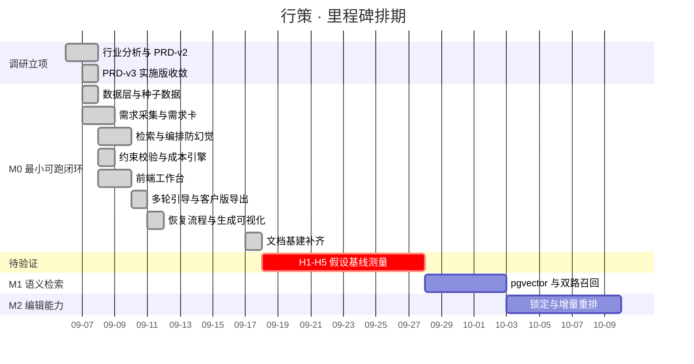

# 功能排期表
## 高端旅行智能方案生成平台「行策」

| 项 | 内容 |
| --- | --- |
| 文档类型 | MVP / 开发阶段 · 功能排期表 |
| 版本 | v1.0 |
| 日期 | 2026-09-17 |
| 说明 | M0 部分为**实际完成记录**（对齐 git 提交）；M1/M2 为**计划**，未排入具体日期 |
| 人力 | 1 人（产品 + 前后端一体，AI 辅助开发），1 人日 ≈ 6 有效小时 |

---

## 1. 里程碑总览

---

## 2. M0 排期明细（已完成）

| # | 功能 | 关联 | 估算 | 实际 | 完成日 | 交付物 |
| --- | --- | --- | --- | --- | --- | --- |
| 1 | 数据模型与迁移（8 张表） | F1/F2/F6 | 1.0 | 1.0 | 09-07 | `alembic/versions/af351a7a956b` |
| 2 | 种子数据生成与约束陷阱注入 | F2/F10 | 1.0 | 1.0 | 09-07 | `seed/`，769 条资源记录 |
| 3 | 槽位 Schema 与抽取 | F1-2/F1-3 | 1.0 | 1.0 | 09-07 | `schemas/slots.py`、`services/extract.py` |
| 4 | 需求卡：合并/完整度/必问项 | F1-4/F1-7 | 0.5 | 0.5 | 09-07 | `services/card.py` |
| 5 | 冲突检测 C1/C2/C3 | F1-6 | 0.5 | 0.5 | 09-07 | `services/conflicts.py` |
| 6 | 硬过滤检索与候选池 | F2-1/F2-2 | 1.0 | 1.0 | 09-08 | `services/retrieval.py` |
| 7 | LLM 编排 + 三道防线 | F3 全部 | 2.0 | 2.0 | 09-08 | `services/planner.py`、`services/render.py` |
| 8 | 硬约束三态校验 H1–H11 | F4 全部 | 1.0 | 1.0 | 09-08 | `services/constraints.py` |
| 9 | 成本规则引擎 | F5 全部 | 0.5 | 0.5 | 09-08 | `services/cost.py` |
| 10 | 异步任务 + 心跳 + 孤儿恢复 | F9-1~4 | 1.0 | 1.0 | 09-08 | `services/tasks.py` |
| 11 | 鉴权、角色、净价隔离、PII | F8 全部 | 1.0 | 1.0 | 09-08 | `core/auth.py`、`core/privacy.py` |
| 12 | API 层与统一错误结构 | —— | 0.5 | 0.5 | 09-08 | `api/v1/*` |
| 13 | 前端三栏工作台 | F7-1 | 2.0 | 2.0 | 09-08 | `features/workspace` |
| 14 | 评测集 20 例 + 跑测脚本 | F10-1/2 | 1.0 | 1.0 | 09-08 | `eval/` |
| 15 | DeepSeek 接入与降级 | F9-5 | 0.5 | 1.0 | 09-08 | `core/llm.py`（超出：兼容端点的 tool_choice 限制） |
| 16 | 多轮引导式采集改造 | F1-5 | 1.0 | 1.5 | 09-10 | `services/guidance.py`（超出：一次一问的交互重构） |
| 17 | 客户版方案与 PDF/长图导出 | F7-3~5 | 1.0 | 1.5 | 09-10 | `customer-proposal.tsx`、`export-proposal.ts` |
| 18 | 候选不足恢复流程 | F9-6 | 0.5 | 1.0 | 09-11 | `candidate_recovery_details`（超出：前端一键应用交互） |
| 19 | 生成过程可视化 | F7-1 | 0.5 | 0.5 | 09-11 | `task-progress.tsx` |
| 20 | 测试补齐（后端 112 + 前端 12 + E2E） | —— | 1.0 | 1.5 | 09-11 | `backend/tests`、`frontend/tests`、`frontend/e2e` |
| 21 | README 与截图 | —— | 0.5 | 0.5 | 09-15 | `README.md`、`docs/screenshots` |
| 22 | 文档基建补齐（本批 01–10） | —— | 1.0 | 1.0 | 09-17 | `docs/01` ~ `docs/10` |
| | **合计** | | **20.0** | **23.0** | | 偏差 +15% |

### 2.1 偏差归因

| 超出项 | 偏差 | 原因 | 教训 |
| --- | --- | --- | --- |
| DeepSeek 接入 | +0.5 | Anthropic 兼容端点的思考模式与强制 `tool_choice` 互斥，需改为「关思考 + 强制工具取结构化」 | **模型兼容层的坑不能按「换个 base_url」估算** |
| 多轮引导改造 | +0.5 | 从「一次抛 3 个问题」改为「一次一问 + AI 分析」，是交互范式变更不是参数调整 | 交互范式变更应单独立项，不算改动 |
| 客户版导出 | +0.5 | A4 分页与长图编码的边界情况 | 前端导出类需求普遍被低估 |
| 恢复流程 | +0.5 | 从「报错」到「给可一键应用的建议」需要服务端产出结构化建议 | **把失败变成可操作的下一步，成本是纯报错的 2 倍**，但值得 |
| 测试补齐 | +0.5 | 三态校验的分支组合多 | 三态设计的测试成本约为二值的 1.5 倍 |

> 20 → 23 人日，偏差 15%，主要来自「把体验做对」而非「把功能做出来」。这个比例可接受；如果偏差来自需求反复，就该复盘范围管理了。

---

## 3. M1 计划（语义检索）

| # | 功能 | 关联 | 估算 | 依赖 | 优先级 |
| --- | --- | --- | --- | --- | --- |
| 1 | pgvector 扩展与向量列迁移 | F2-7 | 0.5 | —— | P0 |
| 2 | 字段模板化文本与 embedding 生成 | F2-7 | 1.0 | 1 | P0 |
| 3 | 双路召回（结构化 + 向量） | F2-7 | 1.5 | 2 | P0 |
| 4 | RRF 融合与业务重排 | F2-7 | 1.0 | 3 | P0 |
| 5 | 中日文混名处理 | F2-7 | 1.0 | 2 | P1 |
| 6 | 召回评测用例扩充（+10 例） | F10-1 | 1.0 | 3 | P0 |
| | **合计** | | **6.0** | | |

**进入条件**：M0 的 G1–G5 全部通过（✅ 已满足）。
**退出条件**：召回评测中「应召回资源进入候选池」的比例达标，且引入向量后 blocking 仍为 0。

---

## 4. M2 计划（编辑能力）

| # | 功能 | 关联 | 估算 | 依赖 | 优先级 |
| --- | --- | --- | --- | --- | --- |
| 1 | 条目替换（从候选池换资源） | F6-2 | 1.0 | —— | P0 |
| 2 | **条目锁定** | F6-3 | 1.0 | 1 | P0 |
| 3 | 增量重排（只改未锁定天） | F6-4 | 2.0 | 2 | P0 |
| 4 | 版本 diff 与回滚 | F6-5 | 1.5 | —— | P1 |
| 5 | 修改行为埋点（顾问修改率） | F10-4 | 1.0 | 1,2 | P0 |
| | **合计** | | **6.5** | | |

**硬验收**：锁定的条目在重排后**完全一致**（字段级比对），不允许「基本一致」。

---

## 5. 前置阻塞项（不排期但必须解决）

| # | 事项 | 阻塞了什么 | 状态 |
| --- | --- | --- | --- |
| B1 | **H1–H5 假设验证**（工时基线、返工归因） | 决定 M1/M2 谁先做 | ⛔ 需业务方配合 |
| B2 | 真实供应商资源接入 | 从演示走向可用 | ⛔ 需数据运营 |
| B3 | 前端埋点实现（F10-4） | 顾问修改率等指标无法观测 | ⛔ 2.5 人日，见[埋点表 §7](05-数据埋点表.md) |

> **B1 是最该先做的事，但它不是开发任务**。继续加功能而不验证假设，是这个项目当前最大的风险。

---

## 6. 排期原则

1. **P0 不跨里程碑**：一个里程碑内的 P0 没做完，不开下一个里程碑；
2. **每个里程碑必须有可验收的门槛**，不以「代码写完」为完成标志；
3. **任何 Badcase 修复必须附带一条新测试用例**（见 [Badcase 收集表](07-Badcase收集表.md)），这部分工时预留在每个里程碑的 15%；
4. 估算按人日，**超出 30% 触发范围复盘**而不是加班。
